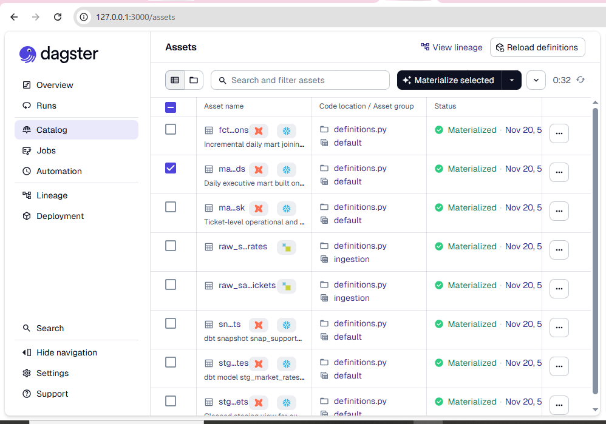

# Multi-Source SaaS Operations & Market Index ELT Engine

An end-to-end **Analytics Engineering & Data Orchestration** pipeline ingesting external SaaS support ticket and market index feeds via **dlt** into **Snowflake**, transforming and snapshotting data with **dbt**, and orchestrating scheduled runs and asset lineage in **Dagster**.

---

## Business Problem

Remote SaaS operations and finance teams need visibility into two connected risks:
1. **Support backlog & escalation risk:** Which support tickets are stalling (`open` with high age or heavy customer interaction), how tickets change state over time, and where triage bottlenecks are forming.
2. **Daily operational pressure vs. billing/market index shifts:** How daily ticket backlog and customer interaction intensity move alongside market/billing index rates (`avg_billing_index_usd` and `total_market_liquidity_usd`).

---

## Architecture & Pipeline Flow
```text
External APIs / Feeds & CRM Account Feed
        │
        ▼
  [dlt Ingestion]  ──►  Snowflake (RAW_SAAS_DATA: raw_support_tickets, raw_market_rates, raw_saas_accounts)
        │
        ├──► [dbt Staging]    ──►  stg_support_tickets, stg_market_rates, stg_saas_accounts
        │       │
        │       ├──► [dbt Snapshot]        ──► snap_support_tickets, snap_saas_accounts (SNAPSHOTS schema, SCD Type 2)
        │       └──► [dbt Incremental Fact] ──► fct_daily_saas_operations (incremental merge, 3-day lookback)
        │                │
        │                ▼
        │      [dbt Business Marts]
        │        ├── mart_ticket_escalation_risk (ticket aging, snapshot history, account context & triage)
        │        └── mart_daily_operations_market_trends (daily backlog ratio, effort & DoD index shifts)
        │
        └──► [dbt Customer Dimension] ──► dim_customers (plan tier, MRR, renewal date, snapshot stats & ticket risk rollups)
                 │
                 ▼
  [Dagster Orchestration] ──► Asset lineage, materializations, asset checks, dbt tests & hourly schedule
```

## Key Models & Data Marts
- **Raw Ingestion (`raw_support_tickets`, `raw_market_rates`, `raw_saas_accounts`)**
  - *Strategy:* dlt ingestion multi-asset (`ingestion` group)
  - *Grain:* Raw source records (tickets, market index coins, and SaaS customer accounts)
  - *Purpose:* Ingests support tickets, market index rates, and customer account/MRR records into Snowflake
- **Staging (`stg_support_tickets`, `stg_market_rates`, `stg_saas_accounts`)**
  - *Strategy:* Staging views/models
  - *Grain:* Ticket / market asset / customer account record
  - *Purpose:* Deduplicates records, standardizes data types and fields, maps `account_id` on tickets, and categorizes engagement
- **Snapshots (`snap_support_tickets`, `snap_saas_accounts`)**
  - *Strategy:* dbt Snapshot (`strategy='timestamp'`, `updated_at='updated_at'`)
  - *Grain:* Entity ID + validity window
  - *Purpose:* Tracks historical changes in ticket status/engagement and SaaS account plan/MRR over time
- **Daily Fact (`fct_daily_saas_operations`)**
  - *Strategy:* Incremental (`merge`, `unique_key='activity_date'`, 3-day lookback)
  - *Grain:* `activity_date`
  - *Purpose:* Combines daily support ticket and interaction counts with daily market index metrics
- **Customer Dimension (`dim_customers`)**
  - *Strategy:* Table
  - *Grain:* `account_id`
  - *Purpose:* Combines customer tier, MRR, renewal date, account snapshot history, ticket/escalation rollups, and `customer_health_status`
- **Escalation Risk Mart (`mart_ticket_escalation_risk`)**
  - *Strategy:* Table
  - *Grain:* `ticket_id`
  - *Purpose:* Computes ticket age, snapshot history, customer account context, and `escalation_risk_tier`
- **Daily Trends Mart (`mart_daily_operations_market_trends`)**
  - *Strategy:* Table
  - *Grain:* `activity_date`
  - *Purpose:* Adds `open_ticket_ratio`, `interactions_per_ticket`, DoD billing index % change, and load status

## Sample Analytical Queries

### 1. High-Risk Open Tickets Needing Triage
```sql
select
    ticket_id,
    account_id,
    company_name,
    plan_tier,
    mrr_usd,
    ticket_number,
    ticket_status,
    interaction_volume_category,
    comments_count,
    ticket_age_days,
    snapshot_record_count,
    escalation_risk_tier
from ANALYTICS.mart_ticket_escalation_risk
where escalation_risk_tier = 'High Escalation Risk'
order by mrr_usd desc nulls last, ticket_age_days desc, comments_count desc;
```

### 2. Daily Backlog Share & Billing Index Momentum
```sql
select
    activity_date,
    total_tickets_updated,
    open_tickets_count,
    open_ticket_ratio,
    interactions_per_ticket,
    avg_billing_index_usd,
    prev_day_billing_index_usd,
    billing_index_dod_pct_change,
    daily_operational_load_status
from ANALYTICS.mart_daily_operations_market_trends
order by activity_date desc;
```

### 3. 360-Degree Customer MRR-at-Risk
```sql
with ticket_metrics as (
    select
        account_id,
        count(*) as total_tickets_logged,
        count_if(escalation_risk_tier = 'High Escalation Risk') as high_risk_tickets,
        count_if(escalation_risk_tier = 'Watchlist - Open') as watchlist_open_tickets,
        round(avg(ticket_age_days), 1) as avg_ticket_age_days,
        max(ticket_age_days) as max_ticket_age_days
    from ANALYTICS.mart_ticket_escalation_risk
    where account_id is not null
    group by account_id
)
select
    c.account_id,
    c.company_name,
    c.plan_tier,
    c.mrr_usd,
    c.contract_renewal_date,
    c.customer_health_status,
    c.account_snapshot_versions,
    c.open_tickets,
    c.high_escalation_risk_tickets,
    c.total_ticket_comments,
    coalesce(tm.watchlist_open_tickets, 0) as watchlist_open_tickets,
    coalesce(tm.avg_ticket_age_days, 0) as avg_ticket_age_days,
    coalesce(tm.max_ticket_age_days, 0) as max_ticket_age_days,
    case
        when c.high_escalation_risk_tickets > 0 then c.mrr_usd
        else 0
    end as mrr_at_risk_usd
from ANALYTICS.dim_customers c
left join ticket_metrics tm
    on c.account_id = tm.account_id
order by mrr_at_risk_usd desc, c.mrr_usd desc, c.high_escalation_risk_tickets desc;
```
---
### Pipeline Lineage & Materialized Assets





---
## How to Run Locally

1. Run dbt models, snapshots, and data tests:
   cd dbt_project
   dbt build

2. Activate the virtual environment and start Dagster:
   cd ..
   .\venv\Scripts\Activate.ps1
   dagster dev

3. Open the Dagster UI on Assets, click Reload definitions if code or dbt models changed, and materialize assets or rely on the scheduled run.