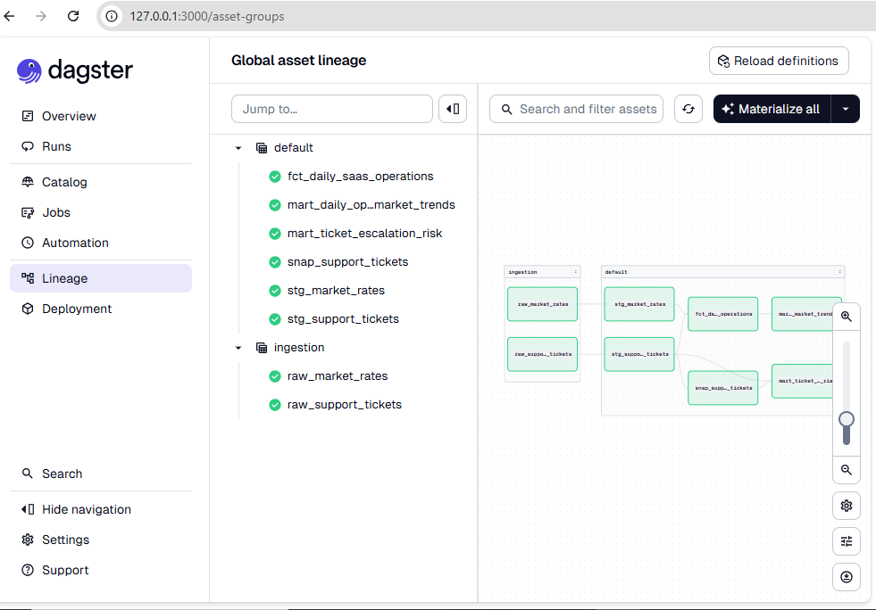

# Multi-Source SaaS Operations & Market Index ELT Engine

An end-to-end **Analytics Engineering & Data Orchestration** pipeline ingesting external SaaS support ticket and market index feeds via **dlt** into **Snowflake**, transforming and snapshotting data with **dbt**, and orchestrating scheduled runs and asset lineage in **Dagster**.

---

## Business Problem

Remote SaaS operations and finance teams need visibility into two connected risks:
1. **Support backlog & escalation risk:** Which support tickets are stalling (`open` with high age or heavy customer interaction), how tickets change state over time, and where triage bottlenecks are forming.
2. **Daily operational pressure vs. billing/market index shifts:** How daily ticket backlog and customer interaction intensity move alongside market/billing index rates (`avg_billing_index_usd` and `total_market_liquidity_usd`).

---

## Architecture & Pipeline Flow

```text
External APIs / Feeds
        │
        ▼
  [dlt Ingestion]  ──►  Snowflake (RAW_SAAS_DATA: raw_support_tickets, raw_market_rates)
        │
        ▼
  [dbt Staging]    ──►  stg_support_tickets, stg_market_rates (deduplication, cleaning, engagement tiers)
        │
        ├──► [dbt Snapshot]        ──► snap_support_tickets (SNAPSHOTS schema, timestamp SCD Type 2)
        └──► [dbt Incremental Fact] ──► fct_daily_saas_operations (incremental merge, 3-day lookback)
                 │
                 ▼
       [dbt Business Marts]
         ├── mart_ticket_escalation_risk (ticket-level aging, snapshot history & escalation triage)
         └── mart_daily_operations_market_trends (daily backlog ratio, effort & DoD index shifts)
                 │
                 ▼
  [Dagster Orchestration] ──► Asset lineage, materializations, data tests & hourly schedule
```
---
### Pipeline Lineage & Materialized Assets





---

## Key Models & Data Marts

* **Raw Ingestion (`raw_support_tickets`, `raw_market_rates`)**
  * **Strategy:** `dlt` ingestion assets (`ingestion` group)
  * **Grain:** Raw source records
  * **Purpose:** Ingests support ticket and market rate feeds into Snowflake

* **Staging (`stg_support_tickets`, `stg_market_rates`)**
  * **Strategy:** Staging views/models
  * **Grain:** Ticket / market asset record
  * **Purpose:** Deduplicates records, standardizes types/fields, and categorizes engagement

* **Snapshot (`snap_support_tickets`)**
  * **Strategy:** dbt Snapshot (`strategy='timestamp'`, `updated_at='updated_at'`)
  * **Grain:** `ticket_id` + validity window
  * **Purpose:** Captures historical changes to ticket status, comments, and timestamps

* **Daily Fact (`fct_daily_saas_operations`)**
  * **Strategy:** Incremental (`merge`, `unique_key='activity_date'`, 3-day lookback)
  * **Grain:** `activity_date`
  * **Purpose:** Joins daily support ticket and interaction metrics with daily market index metrics

* **Escalation Risk Mart (`mart_ticket_escalation_risk`)**
  * **Strategy:** Table
  * **Grain:** `ticket_id`
  * **Purpose:** Computes ticket aging (`ticket_age_days`), snapshot history, and `escalation_risk_tier`

* **Daily Trends Mart (`mart_daily_operations_market_trends`)**
  * **Strategy:** Table
  * **Grain:** `activity_date`
  * **Purpose:** Adds `open_ticket_ratio`, `interactions_per_ticket`, DoD billing index % change, and load status
---

## Key Engineering & Modeling Decisions

* **Incremental `merge` with a 3-day lookback (`fct_daily_saas_operations`):** Re-evaluates the last 3 days of `activity_date` on incremental runs to absorb late-arriving ticket updates or market rate revisions without full-table rebuild costs.

* **Timestamp-based SCD Type 2 snapshots (`snap_support_tickets`):** Preserves historical ticket states (`dbt_valid_from`, `dbt_valid_to`) so ticket-level marts can inspect lifecycle history rather than overwriting state.

* **Complementary mart grains:** Pairs a **ticket-level triage mart** (`mart_ticket_escalation_risk`) for support leads with a **daily trend mart** (`mart_daily_operations_market_trends`) for operational and billing/market monitoring.

* **Automated data quality tests:** Enforces `not_null`, `unique`, and `accepted_values` tests across staging, fact, and mart layers (`dbt build`).

* **Dagster orchestration:** Exposes ingestion, snapshots, dbt models, and tests as unified Dagster assets with an active schedule.

---

## Sample Analytical Queries

### 1. High-Risk Open Tickets Needing Triage
sql

select
    ticket_id,
    ticket_number,
    ticket_status,
    interaction_volume_category,
    comments_count,
    ticket_age_days,
    snapshot_record_count,
    escalation_risk_tier
from ANALYTICS.mart_ticket_escalation_risk
where escalation_risk_tier = 'High Escalation Risk'
order by ticket_age_days desc, comments_count desc;

### 2. Daily Backlog Share & Billing Index Momentum
sql

select
    activity_date,
    total_tickets_updated,
    open_tickets_count,
    open_ticket_ratio,
    interactions_per_ticket,
    avg_billing_index_usd,
    prev_day_billing_index_usd,
    billing_index_dod_pct_change,
    daily_operational_load_status
from ANALYTICS.mart_daily_operations_market_trends
order by activity_date desc;

---

## How to Run Locally

1. Run dbt models, snapshots, and data tests:
   cd dbt_project
   dbt build

2. Activate the virtual environment and start Dagster:
   cd ..
   .\venv\Scripts\Activate.ps1
   dagster dev

3. Open the Dagster UI on Assets, click Reload definitions if code or dbt models changed, and materialize assets or rely on the scheduled run.